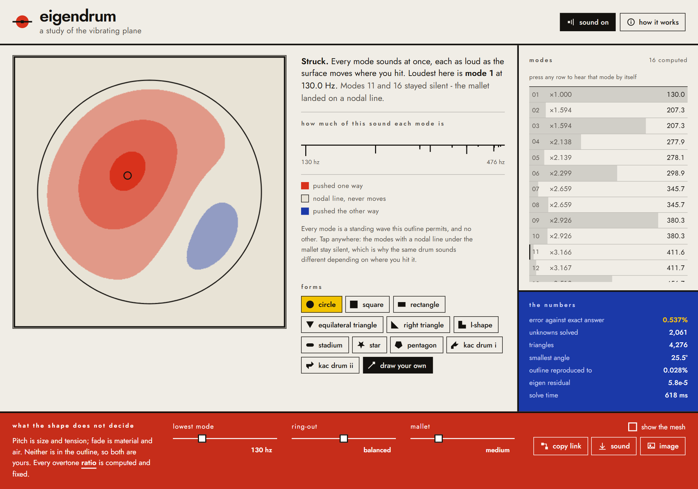
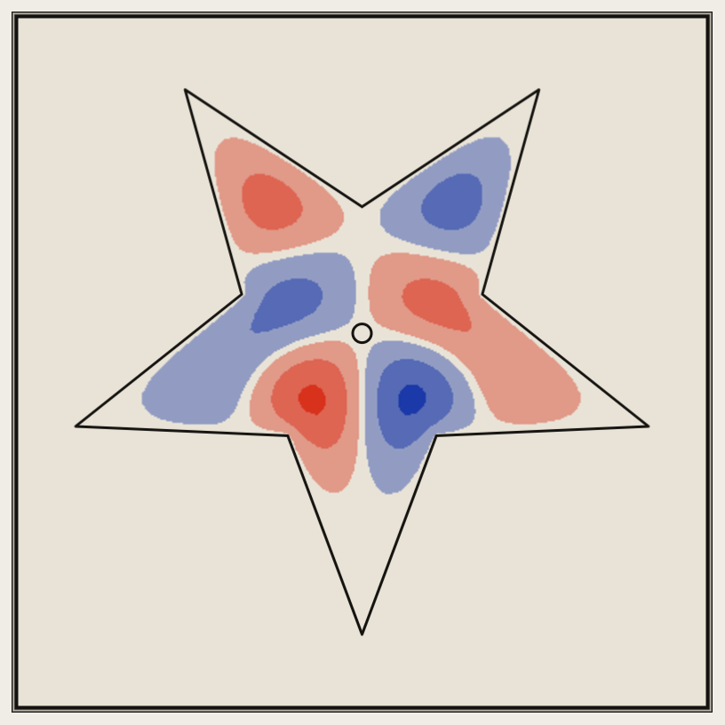
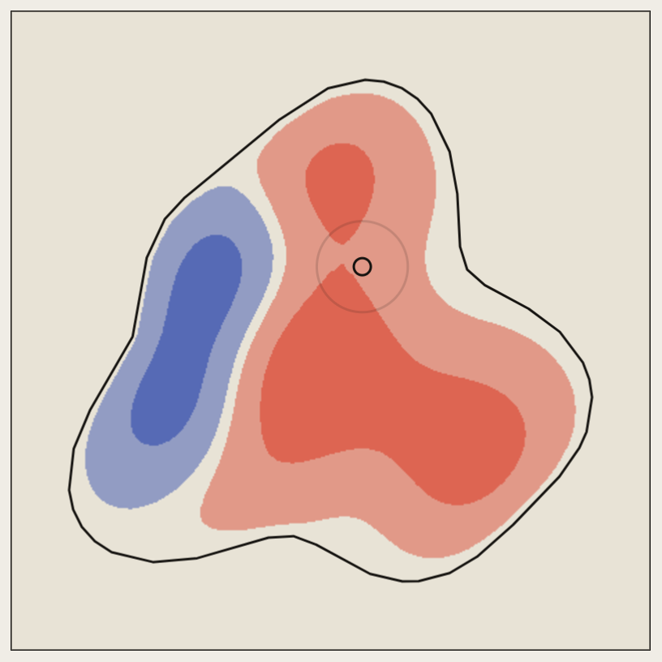
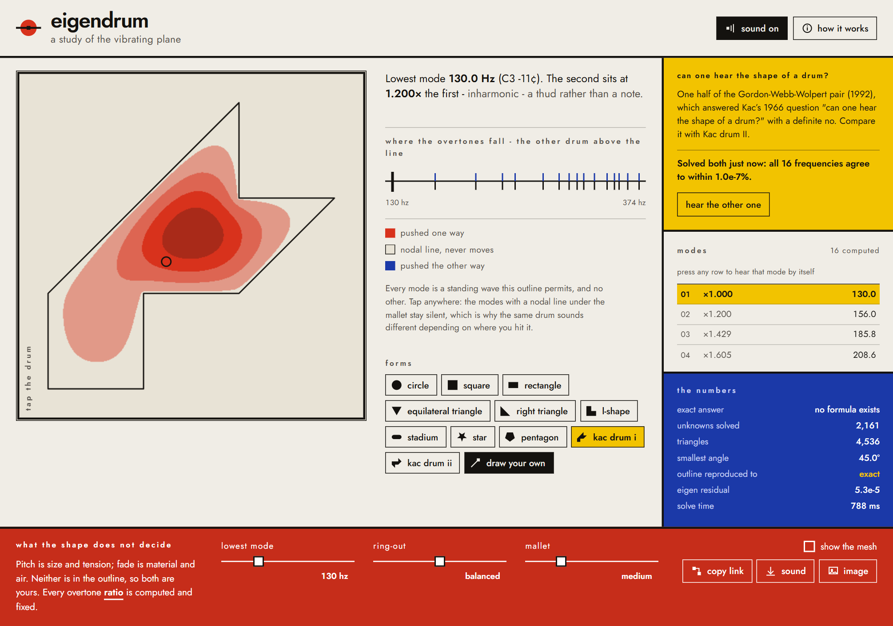

# Eigendrum: everything is a drum

[](https://doi.org/10.5281/zenodo.22019539)

**Draw a shape. Hear the sound it would actually make.**



**Try it at [eigendrum.com](https://eigendrum.com).**

Eigendrum treats your outline as a drumhead clamped at its rim. It splits the shape into thousands of small triangles, solves for the ways the surface can vibrate, and plays those frequencies. Nothing is sampled and no overtone is hand-tuned. Draw a circle and you get the overtones of a real circular drum. Strike a different spot and the sound changes, because a mode only rings if the mallet lands where that mode moves.

The nodal lines you see on the plate are the places that stay still. They are the same patterns Ernst Chladni drew with sand in 1787.

<p align="center">
  
  
</p>

## What you can do

- Click or tap the plate to strike it. The readout names the loudest mode and any mode that stayed silent.
- Press a row in the mode list to hear that mode alone.
- Draw your own outline, or pick one of the built-in shapes, including both Kac drums (below).
- Type an equation instead, in polar `r(t)` or parametric `x(t), y(t)` form. Formulas are read by a small custom parser and never run as JavaScript. The syntax is on the [formulas page](formulas.html).
- Change the reference pitch, the ring-out and the mallet width.
- Share a link, save the strike as a `.wav`, or save the plate as a `.png`.
- Use the keyboard. Tab to the plate and press Enter or Space to strike. If your system asks for reduced motion, the plate holds still.

Your shape stays in your browser. See [privacy.html](privacy.html) for what the site does collect.

## Run it locally

It is a static site with no build step and no runtime dependencies, so any static host can serve it.

```bash
npm run serve     # http://localhost:8080
npm test
```

## Accuracy

The solver is checked against shapes with known exact answers. `npm run bench` reproduces this table, which shows the worst relative error over the lowest 8 modes.

| shape | exact spectrum | 1200 nodes | 2600 | 6000 |
| --- | --- | --- | --- | --- |
| unit square | `π²(m² + n²)` | 0.846% | 0.375% | 0.160% |
| rectangle 1.5 × 0.8 | `π²(m²/a² + n²/b²)` | 1.141% | 0.548% | 0.233% |
| right triangle | square modes with `m ≠ n` | 1.103% | 0.519% | 0.227% |
| unit disk | squared zeros of `J_m` | 0.946% | 0.437% | 0.192% |

The method can only overestimate, so every error is positive. The step-by-step math is on the [how it works page](how-it-works.html).

## Can one hear the shape of a drum?

In 1966 Mark Kac [asked](https://www.jstor.org/stable/2313748) whether knowing every frequency of a drum tells you its shape. In 1992 Gordon, Webb and Wolpert showed it does not, with two different shapes that have identical frequencies. Both are built in as Kac drum I and Kac drum II. Eigendrum solves both and reports how closely the frequencies agree. The [Kac page](hearing-the-shape-of-a-drum.html) has the full story, and `node tools/isospectral.mjs` runs the check yourself.



## Project layout

```
index.html    the page and the About dialog
src/math/     eigensolver, Bessel functions, closed-form spectra, formula parser
src/geom/     polygon cleanup, mesher, equations to outlines
src/fem/      finite element assembly and solve
src/audio/    modal synthesis, WAV encoding, note names
src/app/      interface, canvas, input, presets, sharing
src/worker/   runs the solver off the main thread
tools/        dev server, accuracy bench, browser tests
tests/        node --test
docs/         images used in this README
```

See [CONTRIBUTING.md](CONTRIBUTING.md) for the other scripts.

## Star History

<a href="https://www.star-history.com/?repos=BaselAshraf81%2Feigendrum&type=date&legend=top-left">
 <picture>
   <source media="(prefers-color-scheme: dark)" srcset="https://api.star-history.com/chart?repos=BaselAshraf81/eigendrum&type=date&theme=dark&legend=top-left&sealed_token=aewzcaQJ62zOvbniCf27FkXconx1CdPWnoDE559x0EDP-gBzlnqjFjvwShPrBf6W8wLCM-hUs-d1GdhGzESLv5wjUjSUxEUTFdJDI9ApoVcba3VBR253aQ" />
   <source media="(prefers-color-scheme: light)" srcset="https://api.star-history.com/chart?repos=BaselAshraf81/eigendrum&type=date&legend=top-left&sealed_token=aewzcaQJ62zOvbniCf27FkXconx1CdPWnoDE559x0EDP-gBzlnqjFjvwShPrBf6W8wLCM-hUs-d1GdhGzESLv5wjUjSUxEUTFdJDI9ApoVcba3VBR253aQ" />
   
 </picture>
</a>

## References

- M. Kac, *Can One Hear the Shape of a Drum?*, American Mathematical Monthly 73
  (1966). [JSTOR](https://www.jstor.org/stable/2313748)
- C. Gordon, D. Webb, S. Wolpert, *One cannot hear the shape of a drum*, Bulletin
  of the AMS 27 (1992).
- T. Driscoll, *Eigenmodes of Isospectral Drums*, SIAM Review 39 (1997).
  [SIAM](https://epubs.siam.org/doi/abs/10.1137/S0036144595285069), the source of
  the coordinates used for the two Kac drums.
- [Hearing the shape of a drum](https://en.wikipedia.org/wiki/Hearing_the_shape_of_a_drum)
  on Wikipedia, for the wider history.

## Support

Eigendrum is free. If you want to chip in for the domain and hosting, you can donate at [ko-fi.com/baselashraf](https://ko-fi.com/baselashraf). Bugs go in the issue tracker.

## Licence

See [LICENSE](LICENSE). Code from before this licence took effect remains available under the MIT licence to whoever already had it. Code from here forward is free to use, copy, modify, and redistribute for non-commercial purposes, with visible credit to Basel Ashraf and Eigendrum and no presenting a copy as an unrelated, original work. Commercial use needs a separate licence from Basel Ashraf. The Eigendrum name and logo are not part of this grant either way; see [TRADEMARK.md](TRADEMARK.md).
